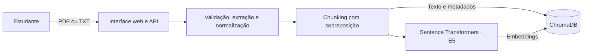
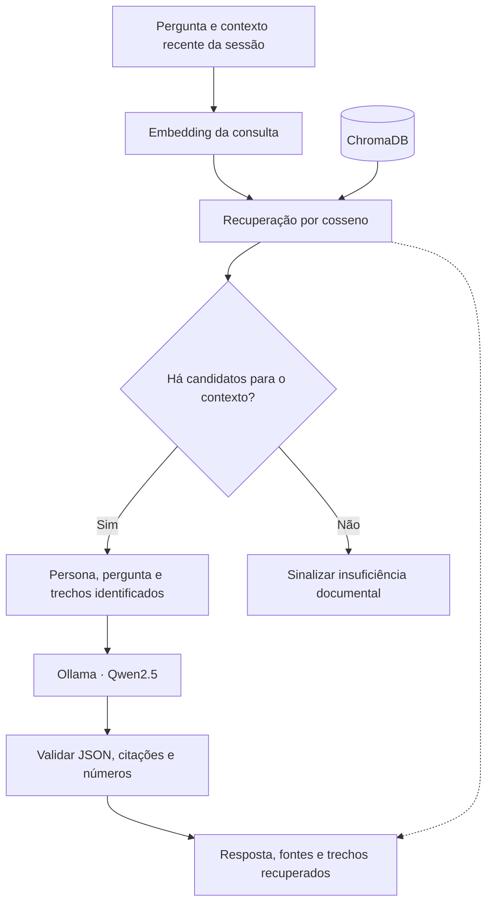

# Arquitetura do Lumifólio

O navegador exibe a interface em HTML, CSS e JavaScript e chama a API Python do FastAPI no mesmo servidor. A API recebe arquivos em `POST /api/documents`, consulta a base em `POST /api/ask` e também oferece listagem, exclusão e carga do acervo de demonstração. Os componentes de PLN operam localmente. O Ollama atende à aplicação por HTTP e executa o modelo generativo na máquina. O ChromaDB mantém a coleção vetorial e os metadados usados na rastreabilidade.

## Indexação

A extração percorre o PDF por página. Para TXT, a unidade de origem é o arquivo. Cada fragmento precisa conservar o identificador do documento e sua posição. A coleção associa o texto e os metadados aos embeddings para que o resultado da busca possa ser exibido e auditado.

## Consulta

## Responsabilidades e fronteiras

| Componente | Dado que recebe | Dado que produz |
| --- | --- | --- |
| Interface | Arquivos e perguntas | Gestão do acervo, conversa, indicadores, fontes e detalhes da busca |
| Processamento documental | Bytes de PDF ou TXT | Texto legível com indicação de página para PDF |
| Chunking | Texto por unidade de origem | Janelas sobrepostas para indexação |
| Embeddings | Texto dos trechos ou da consulta | Vetores normalizados em um espaço compartilhado |
| Armazenamento e recuperação | Vetores, documentos e metadados | Passagens ranqueadas e respectivos escores |
| Prompts e integração | Pergunta, contexto recente e passagens | Objeto de resposta ou indicação de insuficiência |
| Validação | Objeto gerado e conjunto de passagens enviado | Fontes reais associadas às citações aceitas ou erro controlado |

A posição da página e o nome do arquivo vêm do índice. O modelo escolhe identificadores temporários e transcreve evidências. A validação confronta a escolha com o texto recuperado e exige apoio literal para quantidades reconhecidas antes de associar a fonte exibida. A inspeção da busca mostra os candidatos e permite comparar o ranqueamento com o subconjunto efetivamente citado.

O histórico visual guarda até 12 interações no `sessionStorage` da aba. O servidor recebe até três perguntas anteriores para ajudar a interpretar uma continuação. Em perguntas de até 12 palavras com marcadores de referência, a última pergunta anterior é incorporada ao texto vetorizado para busca. Uma continuação explícita como “Por quê?” usa esse histórico. Uma pergunta completa que começa com “Por que” segue sem esse acréscimo se não contiver outro marcador. As respostas anteriores permanecem no histórico visual. Para cada pergunta, a evidência disponível vem da recuperação atual. A interface usa `http://127.0.0.1:8765` e o Ollama atende pelo endereço de loopback configurado, por padrão `http://127.0.0.1:11434`. Os dados vetoriais ficam em `.runtime/chroma` por padrão. Com os modelos já baixados, a consulta local dispensa um provedor de nuvem.

Os métodos são descritos na [metodologia](METODOLOGIA.md) e o contrato de geração na [engenharia de prompts](ENGENHARIA-DE-PROMPTS.md).
